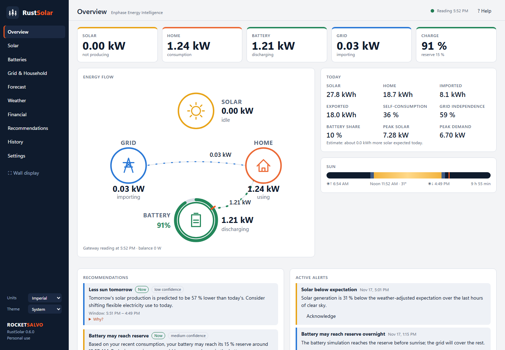
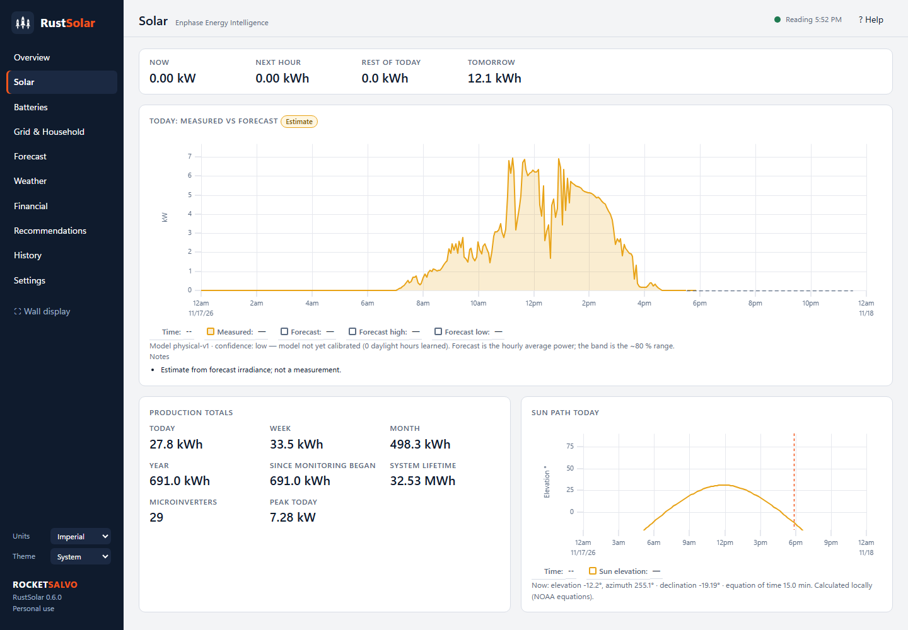
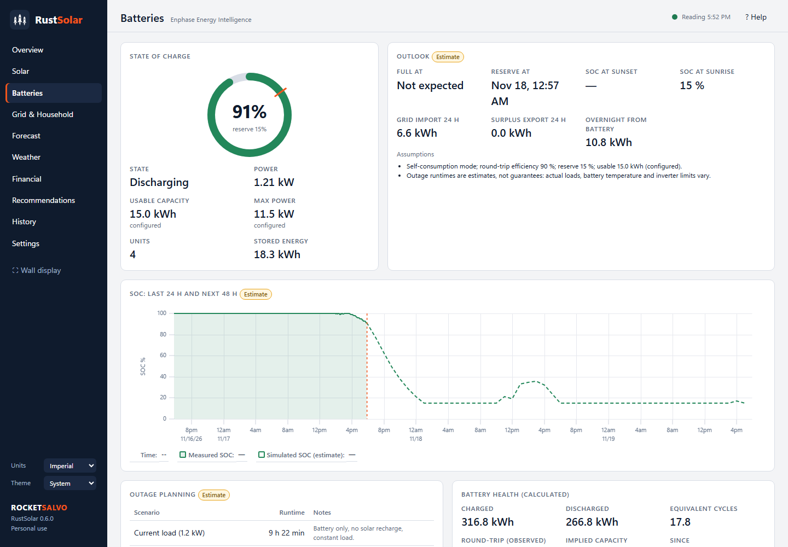
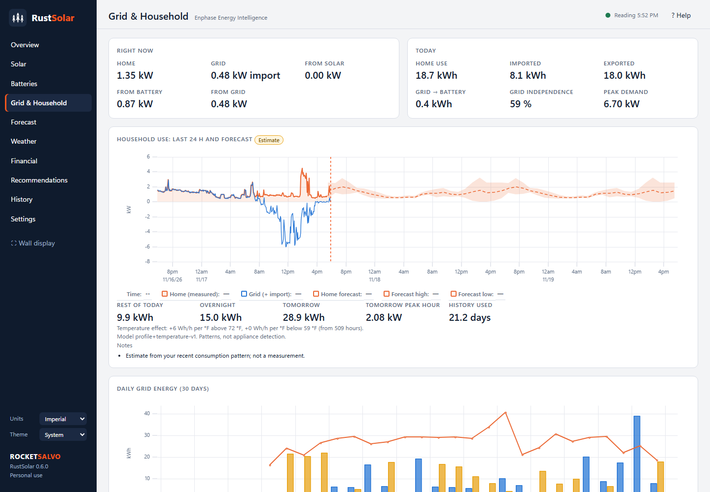
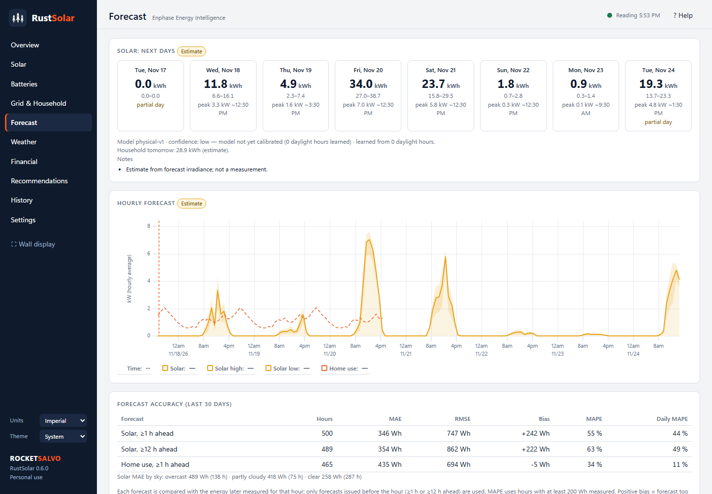
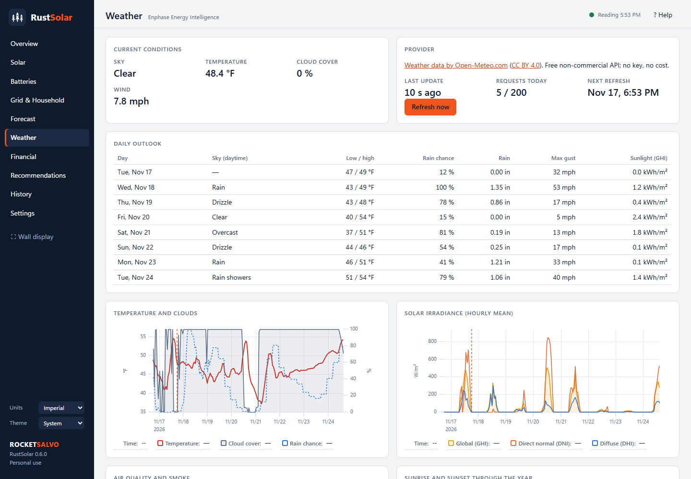
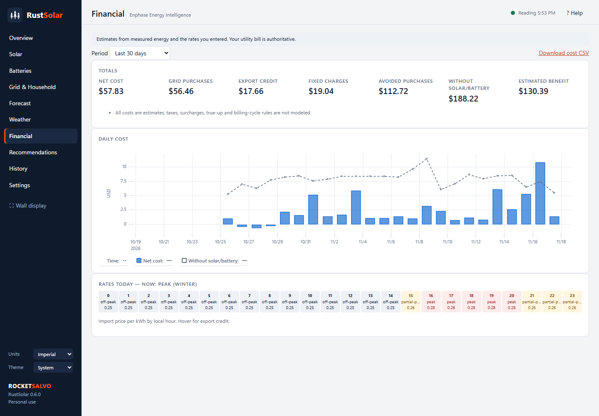
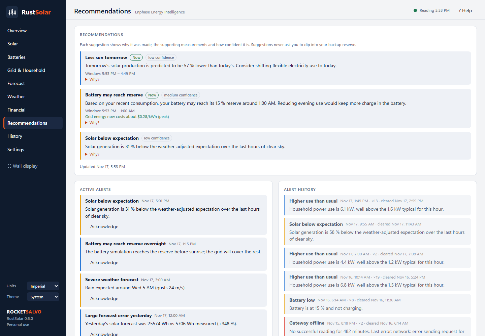
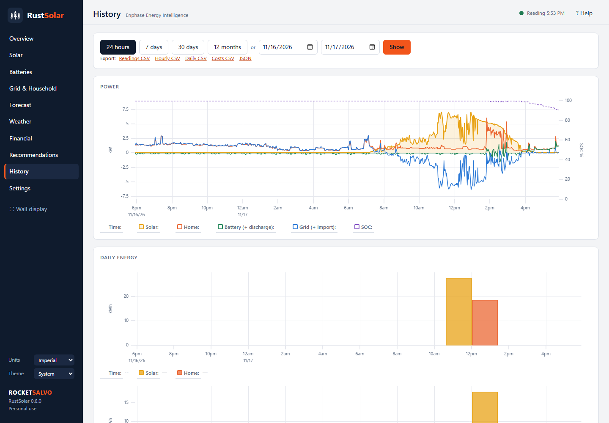

# RustSolar — Enphase Energy Intelligence

A self-hosted solar, battery and home-energy monitor for an Enphase IQ system. It reads
the gateway **locally** (no Enphase cloud API, no subscriptions), stores history in SQLite,
forecasts solar production, household use and battery charge, and serves a dashboard you
can open on any device on your home network.

A RocketSalvo project by Geoffrey Huber. **Free for personal and other noncommercial use** under
the [PolyForm Noncommercial 1.0.0](LICENSE.md) license. Commercial use, including distribution
by solar installers, requires a separate license from the author.
RustSolar is strictly **read-only** with respect to the Enphase system: it only ever sends
HTTP GET requests to the gateway and never changes battery, grid, relay or streaming settings.

## Screenshots



| | |
| --- | --- |
|  |  |
|  |  |
|  |  |
|  |  |

## What it does

| Area | Details |
|---|---|
| Live monitoring | Polls `/ivp/livedata/status` every 12 s (configurable), never overlapping; de-duplicates by gateway timestamp; exponential backoff with jitter; stale-data detection; animated energy-flow diagram. |
| Energy accounting | Integrates power over real elapsed gateway time (trapezoid rule), splits at hour boundaries, never integrates across gaps > 120 s, keeps imports/exports and charge/discharge separate, attributes flows (solar→home, solar→battery, grid→battery, …) consistently with the meters. |
| Sun & weather | Sunrise, sunset, twilights, solar noon, sun path computed locally (NOAA algorithm). Hourly forecast from Open-Meteo's free API (cached; ~50 requests/day). Smoke/air-quality forecast. |
| Solar forecast | Physical model: sun position → Hay–Davies plane-of-array irradiance → Faiman cell temperature → DC/AC with clipping, per roof array. Learns a bias correction from your own production using only forecasts issued before each hour (no leakage). Confidence bands. |
| Household forecast | Recency-weighted hour-of-day profile (weekday/weekend) with an optional temperature term. |
| Battery | SOC simulation (self-consumption): time to full, time to reserve, SOC at sunset/sunrise, expected import/export, outage-runtime scenarios, throughput, equivalent cycles, observed round-trip efficiency. |
| Costs | Configurable tariff engine: TOU, seasons, weekday/weekend/holidays, NEM / fixed / hourly export schedules, fixed charges, baseline credit, tiers, demand charges, plan versions by date. No rates are built in. |
| Recommendations & alerts | Explainable recommendations (why, evidence, confidence, window). Alerts with dedupe, quiet hours, acknowledgement, history, optional webhook. |
| Data | CSV/JSON export, daily backups, retention/downsampling, integrity checks. |

Mock data appears **only** in demo mode (`serve --demo`), which uses a separate database
and shows a "DEMO MODE" banner on every page.

## Quick start (Windows)

```powershell
cargo build --release
.\target\release\rustsolar.exe pin-cert --host 192.168.1.50 --save   # pins the gateway certificate
.\target\release\rustsolar.exe set-token                              # paste the token, Enter, Ctrl+Z, Enter
.\target\release\rustsolar.exe watch                                  # optional: console readings
.\target\release\rustsolar.exe                                        # dashboard on http://127.0.0.1:8080
```

Then open the dashboard → **Settings** and enter your location, roof arrays, battery
details and electricity rates. Everything can also be set in the setup wizard instead of
the command line, including the certificate pin and token.

Data lives in `%LOCALAPPDATA%\RustSolar` (Windows) or `~/.local/share/rustsolar` (Linux):
`config.toml`, `gateway.token`, `rustsolar.db`, `logs/`, `backups/`. Override with
`--data-dir` or `RUSTSOLAR_DATA_DIR`.

### Getting a gateway token

Sign in at <https://entrez.enphaseenergy.com> with your Enlighten account, choose your
site and gateway serial, and create a token. Homeowner tokens are long-lived (about a
year); RustSolar warns 14 days before expiry. The token is stored only in the token file
(or the `RUSTSOLAR_GATEWAY_TOKEN` environment variable), is never logged, never sent to
the browser, and never sent anywhere except your gateway.

## Commands

| Command | Purpose |
|---|---|
| `rustsolar` / `rustsolar serve` | Collector + dashboard. `--demo` for synthetic data. |
| `rustsolar pin-cert --host IP [--save]` | Show / pin the gateway certificate SHA-256. |
| `rustsolar set-token` | Store the gateway token (read from stdin, not the command line). |
| `rustsolar watch` | Print live readings to the console. |
| `rustsolar discover` | Probe read-only endpoints and report which work. |
| `rustsolar check-config` | Validate `config.toml`. |
| `rustsolar hash-password` | Hash a dashboard password for `server.password_hash`. |
| `rustsolar backup [--out FILE]` / `restore FILE --force` | Database backup / restore. |
| `rustsolar rebuild-energy [--days N]` | Recompute hourly energy from raw samples. |

## Security

- Gateway TLS: certificate **pinned by SHA-256** (the gateway's certificate is issued by
  an Enphase private CA for a `*.enphaseenergy.com` name, so normal validation cannot work
  with an IP address). A CA-file mode exists; `insecure_dev` is for development only and
  logs a warning on every start.
- Dashboard binds to `127.0.0.1:8080` by default. To use it from a tablet, set
  `server.bind = "0.0.0.0:8080"` **and** a password (`rustsolar hash-password`); the server
  refuses to start on a network address without one unless you set
  `allow_unauthenticated_lan = true`.
- Argon2id password hashing, HttpOnly SameSite=Strict session cookie, CSRF header check on
  every change, strict Content-Security-Policy, no third-party scripts, analytics or fonts.

## Costs and external services

Zero recurring cost. The only internet services are Open-Meteo forecast and air-quality
APIs (free for non-commercial use, no key). See [docs/EXTERNAL-SERVICES.md](docs/EXTERNAL-SERVICES.md).

## More

- [docs/ARCHITECTURE.md](docs/ARCHITECTURE.md) — design, modules, data model, models and their assumptions
- [docs/DEPLOYMENT.md](docs/DEPLOYMENT.md) — Windows startup task, Linux/Raspberry Pi 5 systemd service, backups
- [docs/tariff-example.toml](docs/tariff-example.toml) — tariff structure (placeholder prices, not real rates)

## Building

Rust stable (edition 2024). The web UI is TypeScript in `web/`, bundled with esbuild into
`web/dist/`, which is embedded in the executable at compile time (so `cargo build` alone
works). To change the UI: `cd web && npm install && npm run build`, then `cargo build`.

Checks: `cargo fmt --all`, `cargo clippy --workspace --all-targets -- -D warnings`,
`cargo test --workspace`, and `cd web && npm run check`.
